# 🏗️ BackIt architecture

This guide shows how BackIt works under the hood: the parts, how money moves, and what keeps it safe.
The diagrams use [Mermaid](https://mermaid.js.org/), so they render on GitHub.

> 📜 For exact request and response shapes, see [`api-contract.md`](api-contract.md).

## Contents

1. [The big picture](#-the-big-picture)
2. [The pieces](#-the-pieces)
3. [Sign-in and API auth](#-sign-in-and-api-auth)
4. [Two kinds of deals](#-two-kinds-of-deals)
5. [Checkout with PayPal](#-checkout-with-paypal)
6. [Referral rewards: from sale to payout](#-referral-rewards-from-sale-to-payout)
7. [Refunds](#-refunds)
8. [Telling the builder's app: webhooks and access codes](#-telling-the-builders-app-webhooks-and-access-codes)
9. [Where AI helps (and where it doesn't)](#-where-ai-helps-and-where-it-doesnt)
10. [The worker](#-the-worker)
11. [State machines](#-state-machines)
12. [Data model](#-data-model)
13. [Deployment](#-deployment)
14. [Safety rules we never break](#-safety-rules-we-never-break)

---

## 🗺️ The big picture

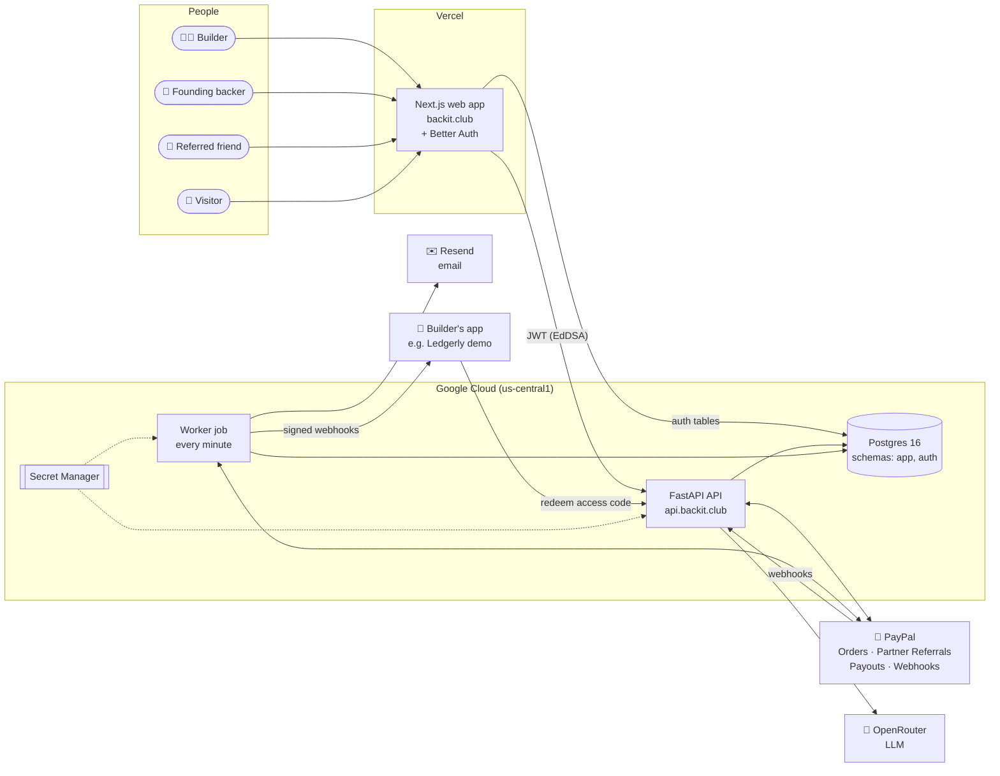

**In one line:** the web app is the face, the API owns every rule about money, the worker does slow and retryable jobs, and PayPal moves the actual cash.

---

## 🧱 The pieces

| Piece | Tech | Where it lives | What it does |
|---|---|---|---|
| 🌐 Web app | Next.js 16, React 19, shadcn/ui, Tailwind v4, TanStack Query | Vercel, `backit.club` | Landing, Explore, campaign pages, checkout, builder and backer dashboards |
| 🔐 Auth | Better Auth (Google sign-in, JWT plugin) | Inside the web app, `auth` schema | Signs users in and issues short-lived JWTs for the API |
| ⚡ API | FastAPI, SQLAlchemy, Pydantic, Alembic | Cloud Run service `backit-api` | Every rule: pricing, checkout, refunds, holds, payouts, risk, ledger |
| ⏱️ Worker | Same code, `python -m app.workers.run --once` | Cloud Run job `backit-worker` | Outbox jobs, PayPal event inbox, builder webhooks, emails, holds, order expiry |
| 🗄️ Database | Postgres 16 | Managed Postgres / local | `app` schema for BackIt, `auth` schema for Better Auth |
| 💙 Payments | PayPal Orders v2, Partner Referrals, Payouts, Webhooks | PayPal sandbox | Takes payments, onboards builders, pays backers |
| 🤖 AI | OpenRouter with JSON-schema output | External | Drafts, offer advice, share posts, payout and risk explanations |
| ✉️ Email | Resend | External | Sale and payout notifications (skipped when no key is set) |
| 🧩 Demo product | FastAPI + SQLite | Cloud Run `backit-test-app` | A pretend builder app ("Ledgerly") that receives webhooks |

### Code map

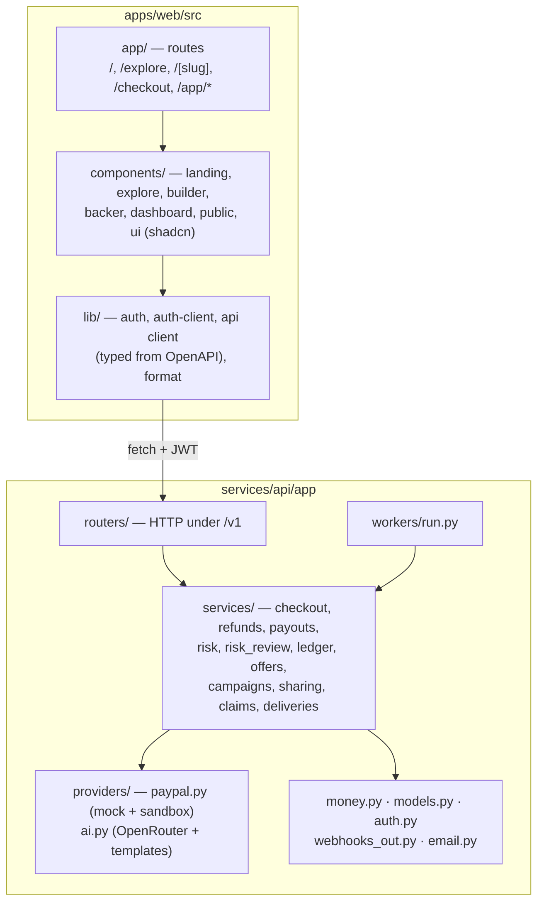

The web app's API types are generated from FastAPI's OpenAPI schema (`npm run api:types`), so both sides stay in sync.

---

## 🔐 Sign-in and API auth

Only Google sign-in is open to the public. The web app hands the API a short-lived signed token, and the API checks it against the web app's public keys.

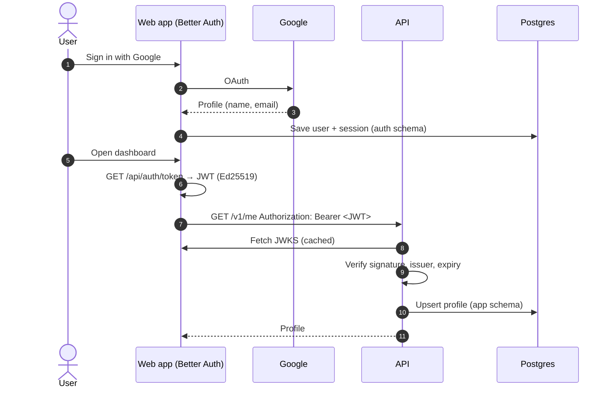

- The API never reads the `auth` schema. It trusts only the signed token.
- Config: `AUTH_JWKS_URL` and `AUTH_ISSUER` on the API, `BETTER_AUTH_URL` on the web.

---

## 🎟️ Two kinds of deals

Every campaign has **two** prices. This is the core idea of BackIt.

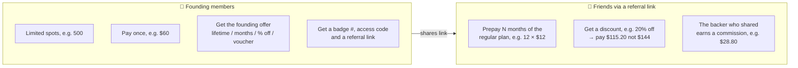

All maths happens on the server in integer cents, with rates in basis points (`money.py`):

```
list        = monthly_price × months
discount    = round_half_up(list × discount_bps / 10000)
amount      = list − discount
commission  = round_half_up(amount × commission_bps / 10000)
platform_fee= round_half_up(amount × 800 / 10000)        # 8%
```

The **AI offer advisor** suggests the founding price, spots, discount and commission, and explains why. It also projects what the builder keeps. The builder can still change every number. The founding price stays a little below what a referred friend pays for the same access (75–95% of it), so founding members get the best deal and the friend link is still worth using.

---

## 💳 Checkout with PayPal

The builder is the merchant of record. BackIt's 8% fee is taken through PayPal's `platform_fees` on the same order.

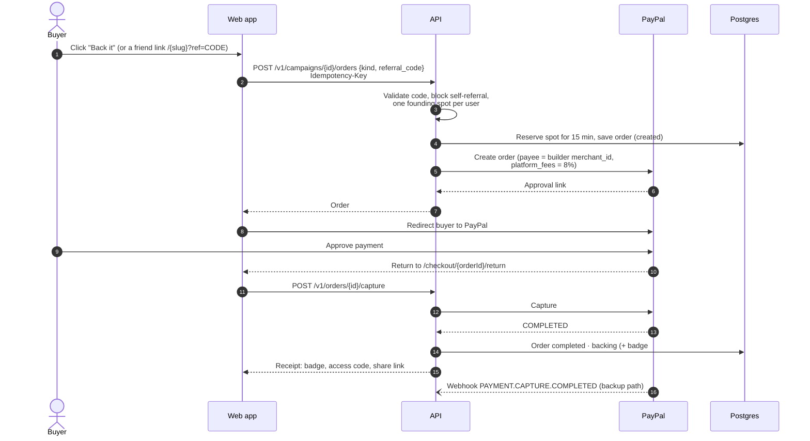

- If PayPal says "pending", the order becomes `pending_provider` and the webhook finishes it later.
- Unpaid reservations expire, and the worker frees the spot.
- Repeating a request with the same `Idempotency-Key` returns the same result, so a double click can't charge twice.

---

## 💸 Referral rewards: from sale to payout

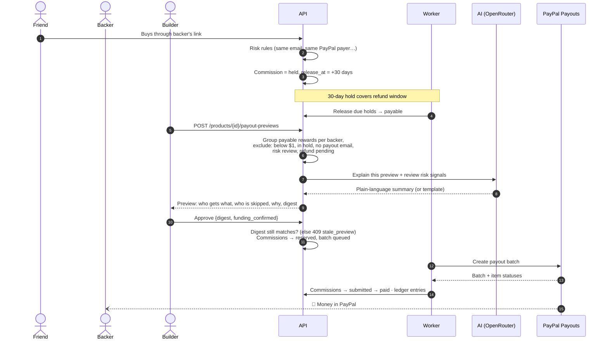

The builder can also **hold** a single backer from a preview if something looks off.

---

## ↩️ Refunds

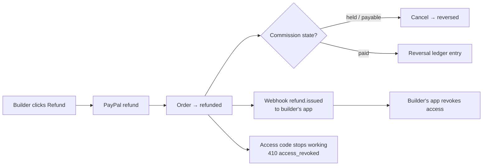

Full refunds only. Each refund writes ledger entries, so the public ledger stays honest.

---

## 🔔 Telling the builder's app: webhooks and access codes

BackIt tells the builder's product when someone buys or gets refunded, so access turns on and off automatically.

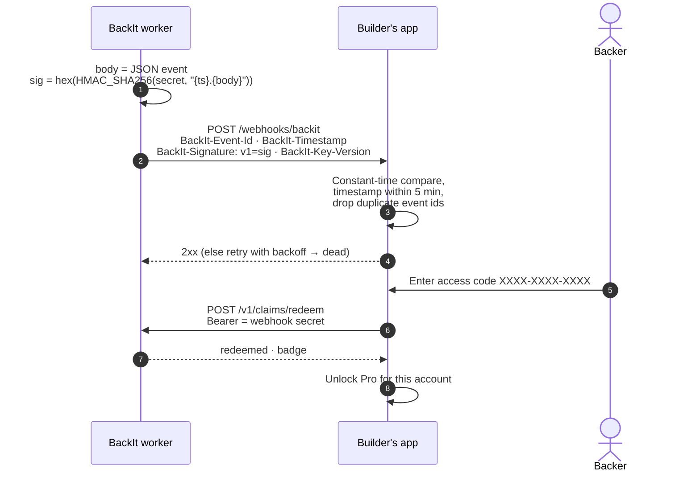

- Events: `ping`, `purchase.completed`, `refund.issued`.
- Outgoing URLs go through an **SSRF guard**: no private or local addresses, except `localhost` in development.
- Webhook secrets are encrypted at rest with `APP_ENCRYPTION_KEY` and shown to the builder only once. They can be rotated.
- Builders can see every delivery, and retry it, on the Setup tab.

---

## 🤖 Where AI helps (and where it doesn't)

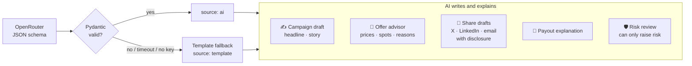

**Hard limits:**

- 🚫 AI never computes money. Prices and totals always come from `money.py`.
- 🚫 AI never moves money. A human approves every payout.
- 🚫 AI can never rate a backer as **safer** than the rules do. It can only flag more risk and explain.
- 📝 Every call is logged in `ai_runs`.

---

## ⏱️ The worker

One loop, run every minute by Cloud Scheduler (or `--loop` locally). Each step claims rows with `FOR UPDATE SKIP LOCKED` and a lease, so two workers never do the same job.

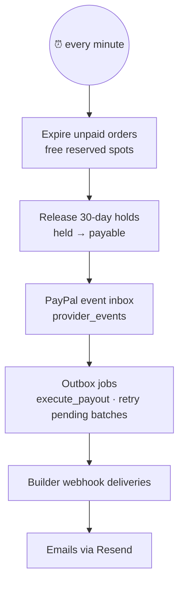

Failed jobs retry with exponential backoff, then become `dead` and show up in the UI.

---

## 🔄 State machines

### Order

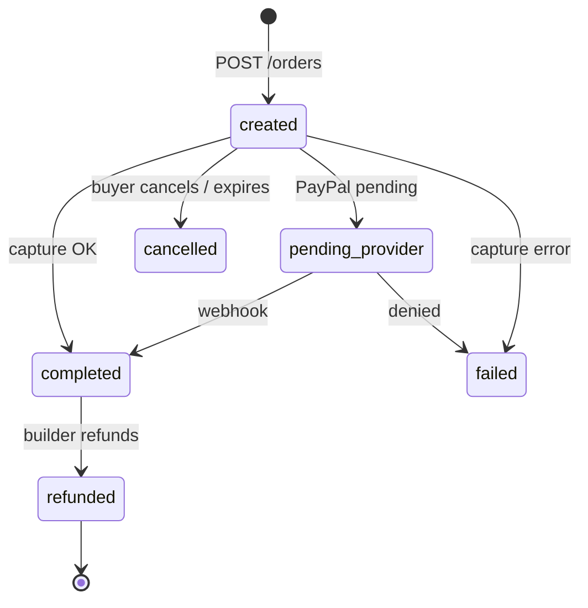

### Commission (backer's reward)

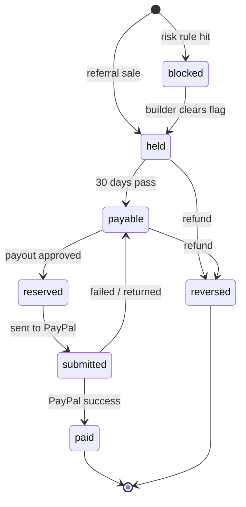

### Payout preview and batch

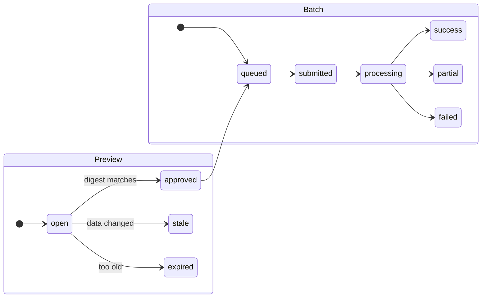

### Campaign

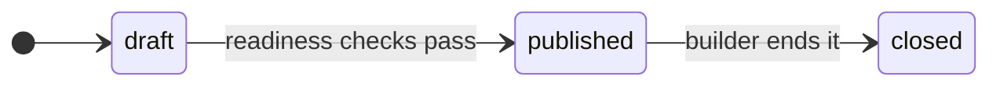

Readiness checks before publishing: PayPal connected, revenue verified (3 months of at least $100), webhook URL set, valid prices and rates, and a free campaign URL.

---

## 🗄️ Data model

Main tables in the `app` schema (IDs are prefixed strings like `prd_`, `cmp_`, `ord_`, `bck_`, `com_`):

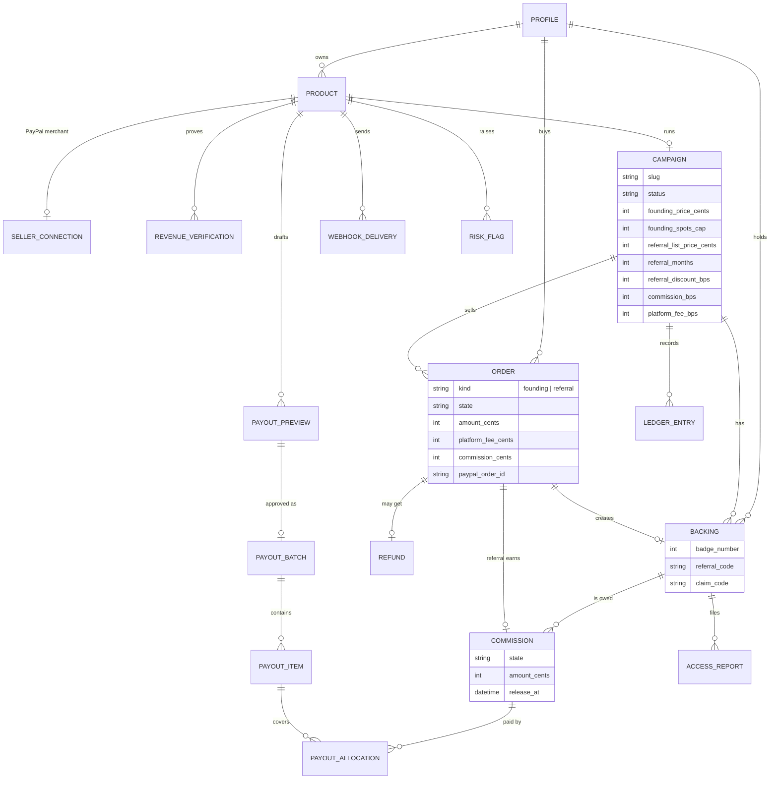

Supporting tables: `provider_events` (PayPal inbox), `outbox_jobs`, `idempotency_keys`, `ai_runs`, `audit_events` and `notifications`.

---

## ☁️ Deployment

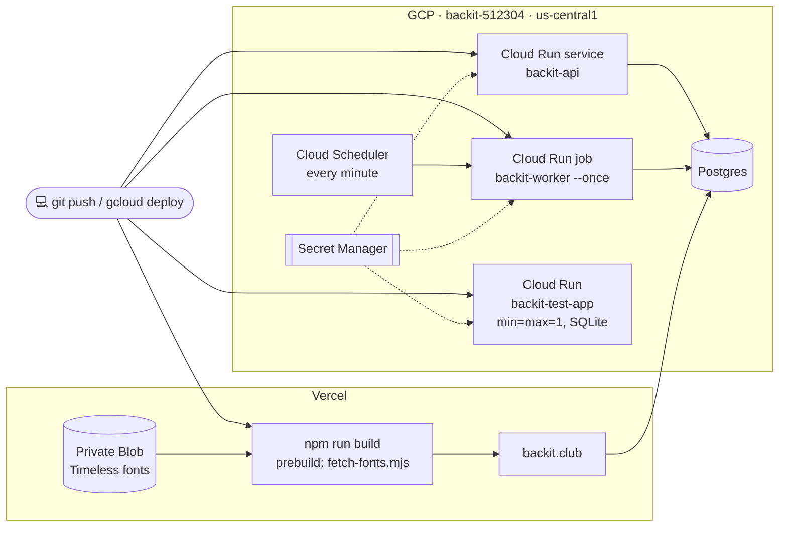

| Host | Domain |
|---|---|
| Web | `https://backit.club` |
| API | `https://api.backit.club` (PayPal webhook: `/v1/webhooks/paypal`) |
| Demo product | `https://test-app.backit.club` |

The fonts are licensed and can't be public, so they're fetched from a private Vercel Blob store at build time and are never committed.

---

## 🛡️ Safety rules we never break

| Rule | How |
|---|---|
| 💰 No floating-point money | Integer cents, basis points, half-up rounding in one place (`money.py`) |
| 🔁 No double charges or payouts | `Idempotency-Key` on money POSTs, unique DB constraints, digest check on payout approval |
| 📒 Every cent is traceable | Append-only `ledger_entries`, plus a public ledger per campaign |
| ⏳ Rewards wait for refunds | 30-day hold, $1 minimum payout |
| 🧍 A human approves money out | Payout preview → explicit approve |
| 🕵️ Fraud checks | Rule-based risk flags (self-referral, shared payer, bursts, new accounts), with AI only able to escalate |
| 🔐 Secrets stay secret | Secret Manager in prod, encrypted webhook secrets, keys never in the repo |
| 🌐 Safe outgoing calls | SSRF guard and HMAC-signed builder webhooks |
| 🧪 Sandbox only | `PAYPAL_MODE` is `mock` or `sandbox`; live PayPal endpoints are never called |
| ⚖️ Not an investment | Backers buy a product deal, not equity or profit share |
