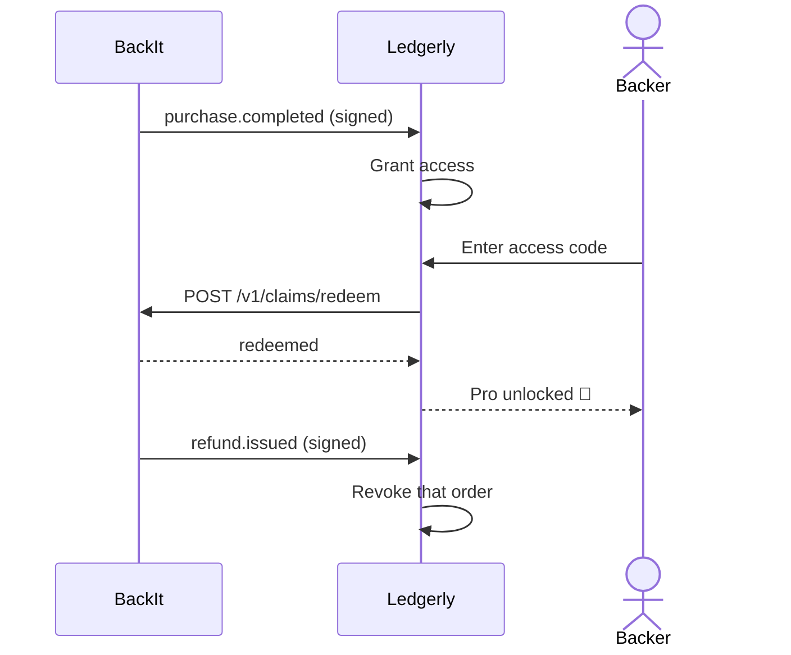

# 🧩 BackIt demo product ("Ledgerly")

A tiny pretend app that shows what a builder's product does with BackIt. Live at **https://test-app.backit.club**.

- 🛒 Buy or refund on [backit.club/ledgerly](https://backit.club/ledgerly) and it shows up in the app's webhook log.
- 🔓 A backer's access code unlocks the fake **Pro** paywall.
- 🔒 Visiting again re-checks the code with BackIt, so a refund locks Pro again.



More on webhooks in [docs/architecture.md](../../docs/architecture.md#-telling-the-builders-app-webhooks-and-access-codes).

## ☁️ Deploy

Cloud Run, one always-on instance so the SQLite log survives between visits (it resets on redeploy):

```bash
gcloud run deploy backit-test-app --source . --region us-central1 --project backit-512304 \
  --allow-unauthenticated --min-instances 1 --max-instances 1 --memory 256Mi
```

⚙️ Env: `APP_NAME`, `CAMPAIGN_URL`, `BACKIT_API_URL`, `BACKIT_PRODUCT_ID`, `CORS_ORIGINS`; the secret `BACKIT_WEBHOOK_SECRET` comes from Secret Manager (`test-app-webhook-secret`). Buyer emails are masked in `/entitlements` because the hosted lists are public.

## 💻 Run locally

It receives signed BackIt webhooks and keeps entitlements in a local SQLite file (`demo.sqlite3`, or `DEMO_DB_PATH`).

```bash
cd examples/demo-product
export BACKIT_WEBHOOK_SECRET=whsec_...   # from POST /v1/products (or rotate)
export BACKIT_PRODUCT_ID=prd_...         # to redeem access codes
export BACKIT_API_URL=http://localhost:8001  # default
uv run fastapi dev --port 8100
```

👉 Set the product's webhook URL in BackIt to `http://localhost:8100/webhooks/backit`. Plain http to localhost is accepted only when the API runs with `ENVIRONMENT=development`.

## 🔌 Endpoints

- `POST /webhooks/backit` checks `BackIt-Signature`, which is `v1=hex(hmac_sha256(secret, "{BackIt-Timestamp}.{raw_body}"))`. The comparison is constant-time, timestamps must be within 5 minutes, and duplicate event ids are dropped. It grants access on `purchase.completed`, revokes only that order on `refund.issued`, and answers `ping`.
- `POST /claims` takes `{code, user_ref}` and redeems the backer's one-time code with `POST {BACKIT_API_URL}/v1/claims/redeem`, using the webhook secret as the bearer token. The secret stays on the server. On success it records `claimed_by` on that order's entitlement.
- `GET /entitlements` returns `[{order_id, buyer_email, plan_id, status, granted_at, revoked_at, claimed_by}]`.
- `GET /events` returns recently processed events.
- `GET /` is the paywall page; `GET /health` is a JSON health check.
- CORS allows GET and POST from `http://localhost:3000` (override with `CORS_ORIGINS`).

## 🧪 Checks

Tests: `uv run pytest`. Lint: `uv run ruff check .`
